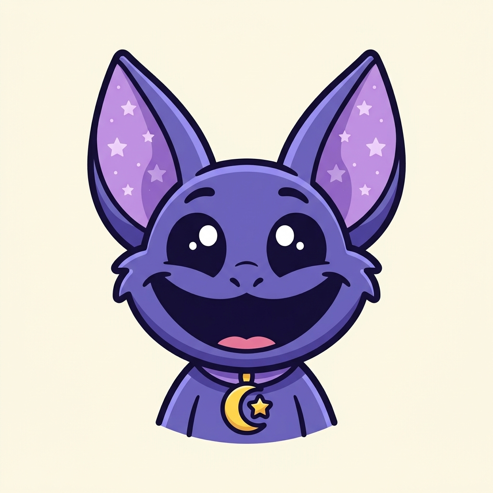
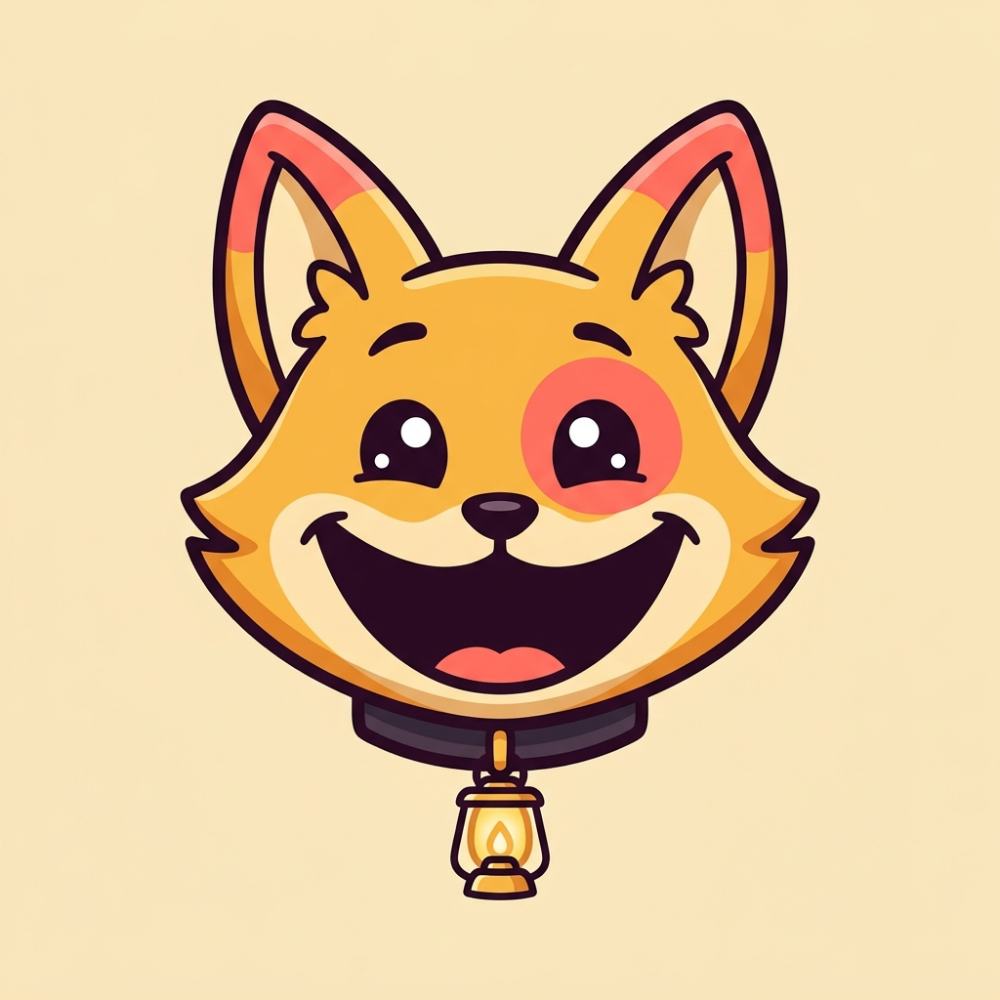
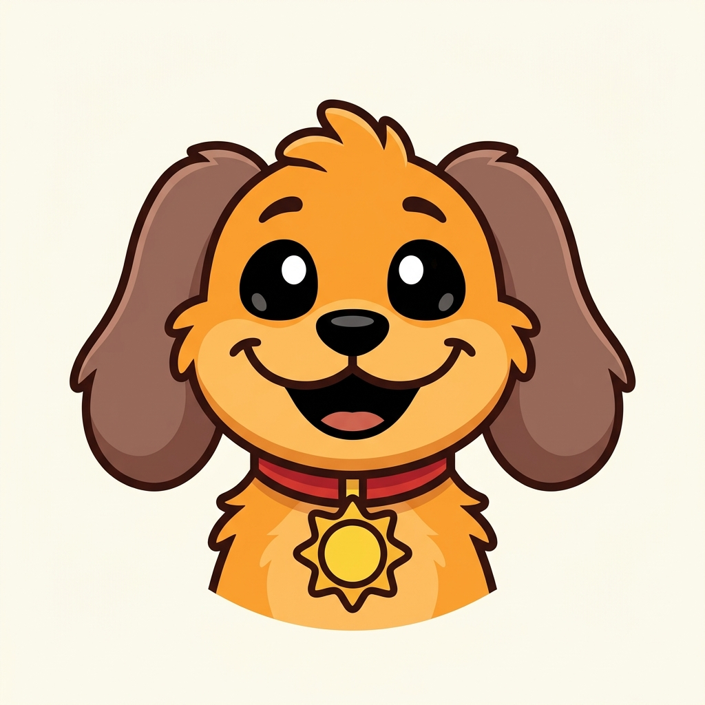
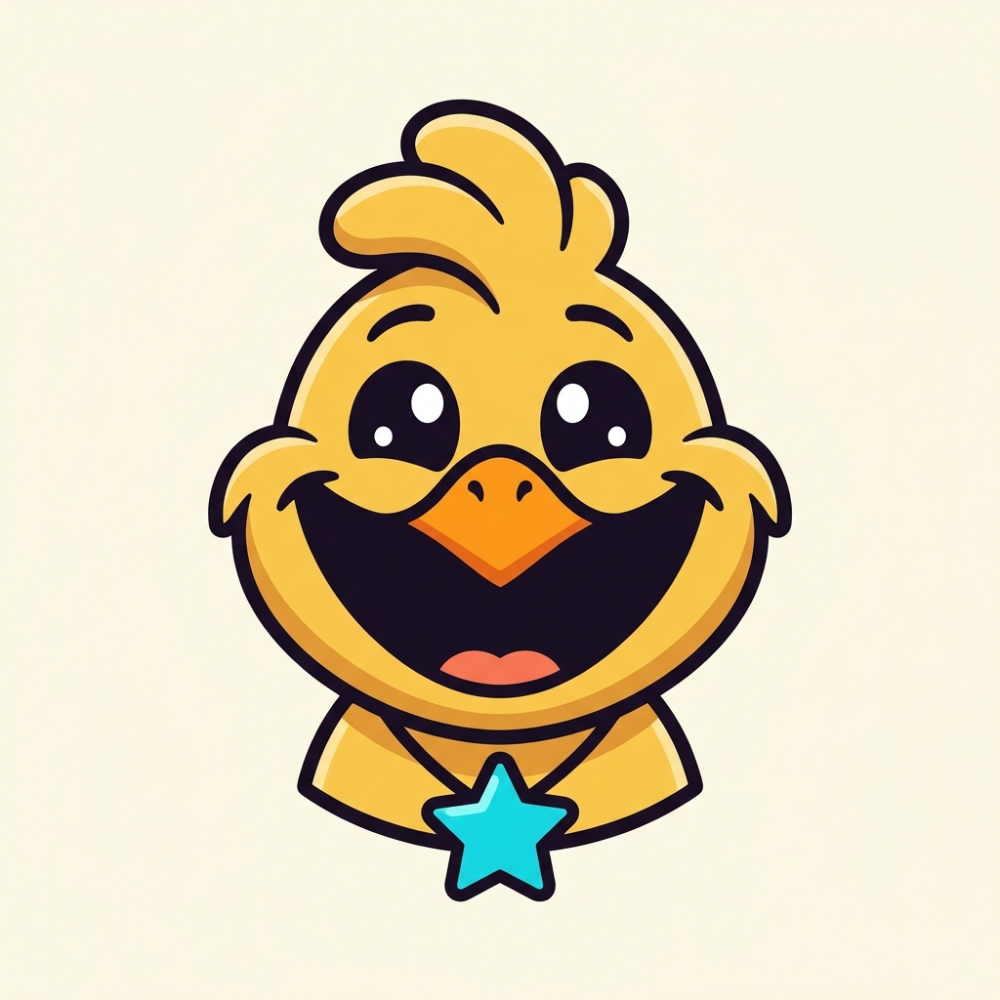
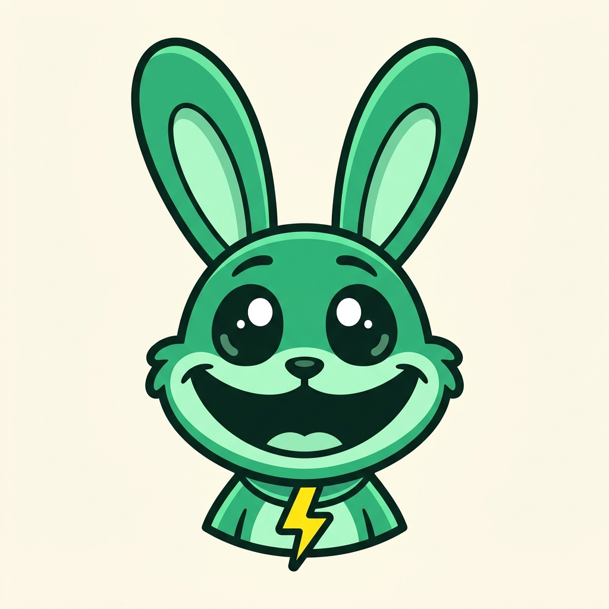
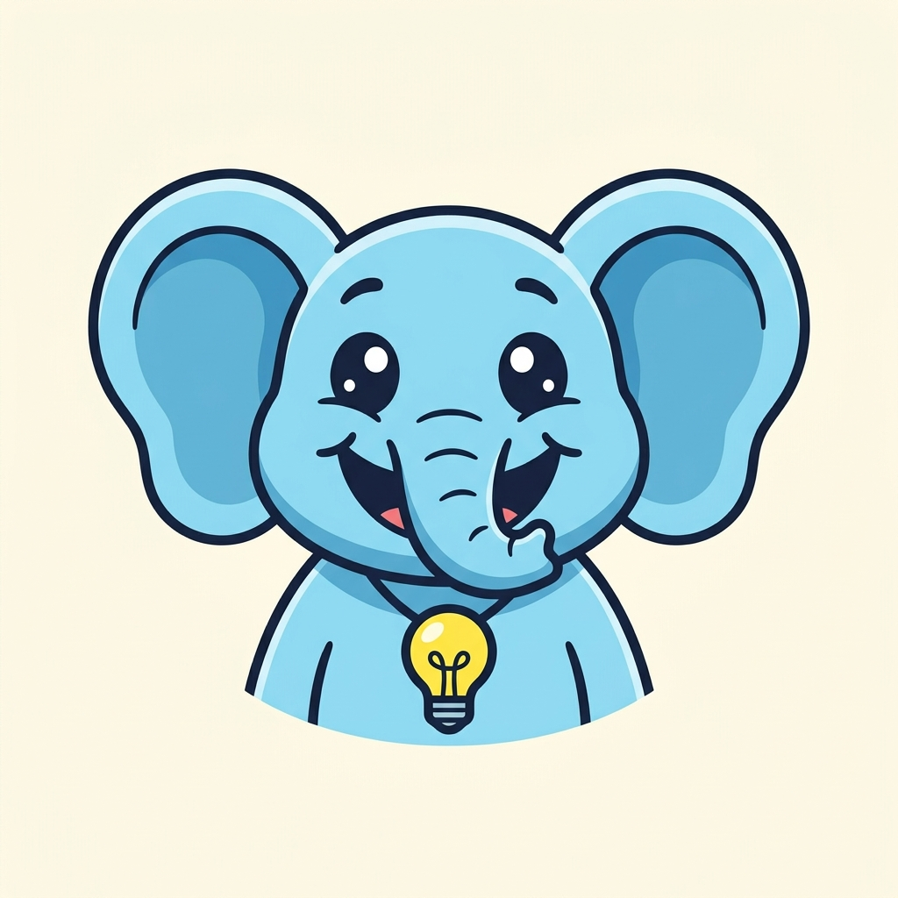
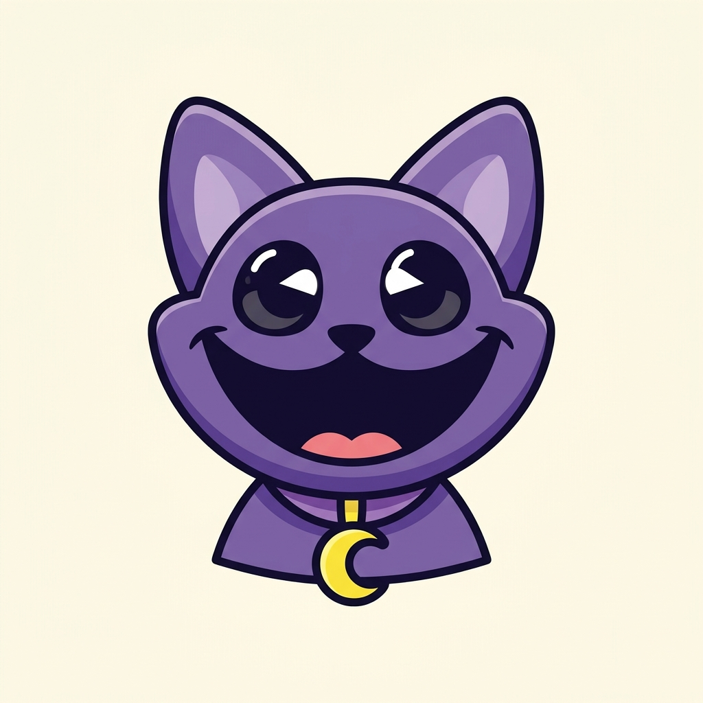
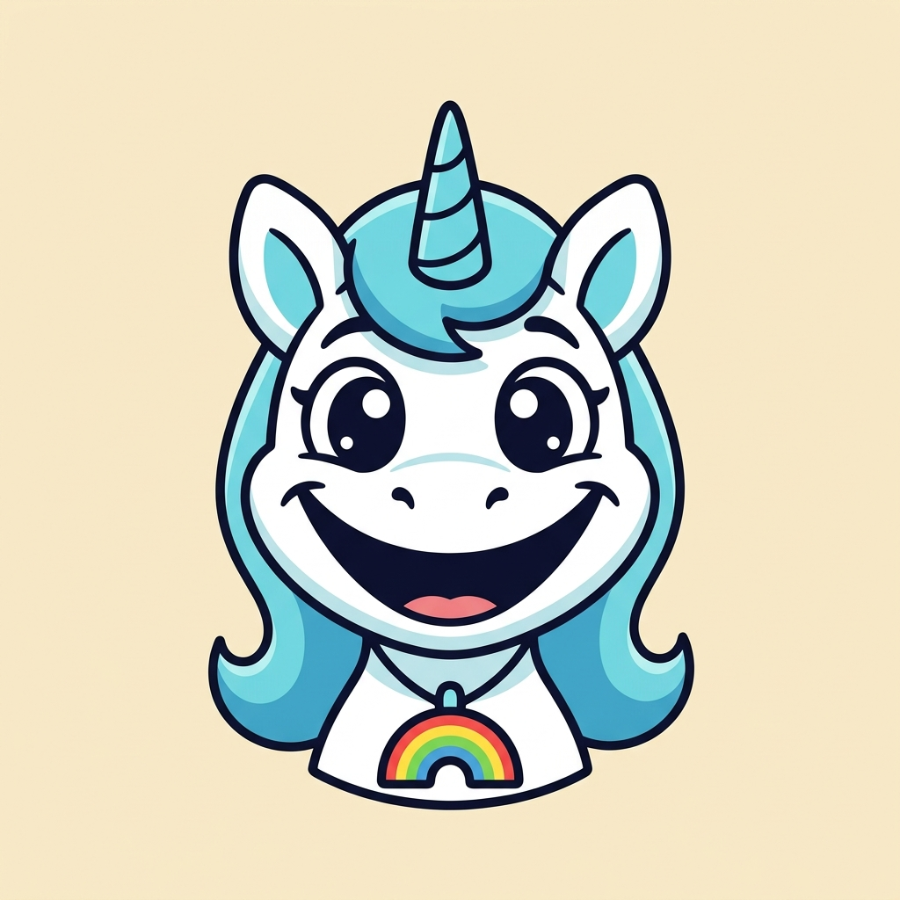

# 📖🌈🦇 《葫芦萌兽传：七彩仙藤与星月小七妹》 — The Calabash Critters (30-Page High-Resolution Picture Book)

> **Classic Chinese *Calabash Brothers* (葫芦娃) Reimagined with Uniform Kawaii Smiling Critters & Chuyu (`LunaBat`), Mom (`SunnyFox`), and Dad (`PoppyDash`)!**

### 🚀 [**Read the Interactive 30-Page Hardcover Picture Book Online → https://kunruiw1991.github.io/critters-calabash-brothers/**](https://kunruiw1991.github.io/critters-calabash-brothers/)

---

## 🌟 Cast of Calabash Critters & Family Guardians (1 Critter = 1 Uniform Icon)

| Icon | Character | Calabash Role & Signature Power |
| :---: | :--- | :--- |
|  | **🌙 Chuyu (`LunaBat`)** | **Seventh Sister (`紫金星月七妹`)** — Born from the 7th Violet-Gold Starlight Gourd; never fooled by cave fog, wields the **Cosmic Treasure Gourd (`紫金宝葫芦`)** that transforms weapons into musical instruments! |
|  | **☀️ Mom Kunrui (`SunnyFox`)** | **Guardian of the Sacred Vine (`金灯狐娘`)** — Shines her **Golden Storm-Lantern (`金光宝灯`)** to nurture the Seven-Colored Seed, heal DogDay's eyes with lotus dew, and guide Chuyu's heart! |
|  | **🍿 Dad Craig (`PoppyDash`)** | **Explorer of Calabash Mountain (`爆米花穿山侠`)** — Waters the vine in his **Yellow Rubber Ducky Swim Ring**, roasts mountains of golden popcorn with 4th Brother Hoppy, and cheers on all seven children! |
|  | **❤️ 1st Brother (`Bobby BearHug`)** | **Red Gourd (`大娃·红心大力熊`)** — Grows to mountain size (`力大无穷`) to lift giant boulders! |
|  | **🧡 2nd Brother (`DogDay`)** | **Orange Gourd (`二娃·千里眼顺风耳犬`)** — Golden sunbeam eyes (`千里眼`) and wind-listening ears (`顺风耳`)! |
|  | **💛 3rd Brother (`KickinChicken`)** | **Yellow Gourd (`三娃·铜头铁臂金鸡`)** — Unbreakable golden feathers (`铜头铁臂`) that bounce bronze mallets into sparks! |
|  | **💚 4th Brother (`Hoppy Hopscotch`)** | **Green Gourd (`四娃·翠雷火兔`)** — Breathes warm starfire (`阳刚真火`) to pop mountains of golden popcorn! |
|  | **🩵 5th Brother (`Bubba Bubbaphant`)** | **Blue Gourd (`五娃·清泉水象`)** — Inhales floods and spouts crystal rainbow fountains (`吞吐百川`)! |
|  | **💙 6th Brother (`CatNap`)** | **Indigo Gourd (`六娃·隐身紫月猫`)** — Melts into starry lavender invisibility mist (`来去无踪`) to take the green Jade Scepter (`玉如意`)! |
|  | **🌈 Rainbow Weaver (`CraftyCorn`)** | **Guardian Unicorn (`彩云独角兽`)** — Helps weave the Seven-Colored Vine Sky Bridge from **San Francisco (Golden Gate)** to **Boston**! |

---

## 📚 Complete 30-Page High-Resolution Story Index

- **Act I (Pages 1–6) — The Sacred Vine & Seven Gourds (`第一卷：七彩仙藤`)**:
  - `Page 01`: Morning Rainbow Over Calabash Mountain (`pages/page_01.jpg`)
  - `Page 02`: The Ancient Cavern Seal Trembles (`pages/page_02.jpg`)
  - `Page 03`: Gift of the Seven-Colored Calabash Seed (`pages/page_03.jpg`)
  - `Page 04`: Watering the Vine in a Yellow Ducky Swim Ring (`pages/page_04.jpg`)
  - `Page 05`: Seven Smiling Rainbow Gourds Bloom (`pages/page_05.jpg`)
  - `Page 06`: Cave Winds & The Awakening of First Brother (`pages/page_06.jpg`)
- **Act II (Pages 7–12) — Strength, Vision & Golden Armor (`第二卷：大力、千里眼与铜铁三娃`)**:
  - `Page 07`: Giant Bobby BearHug Lifts the Mountain Boulder (`pages/page_07.jpg`)
  - `Page 08`: The Pink Cotton-Candy Marshmallow Trap (`pages/page_08.jpg`)
  - `Page 09`: Second Brother DogDay’s Clairvoyant Sun-Eyes (`pages/page_09.jpg`)
  - `Page 10`: SunnyFox’s Lantern & Lotus Dew Heal DogDay (`pages/page_10.jpg`)
  - `Page 11`: Third Brother KickinChicken’s Unbreakable Golden Wings (`pages/page_11.jpg`)
  - `Page 12`: Wrapped in a Giant Pink Silk Ribbon Bow (`pages/page_12.jpg`)
- **Act III (Pages 13–18) — Fire, Water & Invisible Mist (`第三卷：水火双娃与隐身六娃`)**:
  - `Page 13`: Fourth & Fifth Brothers: Starfire & Rainbow Water (`pages/page_13.jpg`)
  - `Page 14`: Fourth Brother Roasts a Mountain of Golden Popcorn (`pages/page_14.jpg`)
  - `Page 15`: Fifth Brother’s Rainbow River & Dad’s Ducky Floatie (`pages/page_15.jpg`)
  - `Page 16`: A Cozy Nap on Pink Lotus Cushions (`pages/page_16.jpg`)
  - `Page 17`: Sixth Brother CatNap’s Invisible Starlight Mist (`pages/page_17.jpg`)
  - `Page 18`: CatNap Lifts the Jade Scepter & Frees His Brothers (`pages/page_18.jpg`)
- **Act IV (Pages 19–24) — Seventh Sister Chuyu (`LunaBat`) & The Starlight Gourd (`第四卷：星月七妹小蝙蝠`)**:
  - `Page 19`: The Seventh Violet-Gold Gourd Shines Through the Mist (`pages/page_19.jpg`)
  - `Page 20`: Seventh Sister Chuyu (`LunaBat`) Awakens! (`pages/page_20.jpg`)
  - `Page 21`: Mom’s Golden Lantern & Dad’s Call Guide Chuyu’s Heart (`pages/page_21.jpg`)
  - `Page 22`: Chuyu’s Treasure Gourd Sweeps Away Every Cave Weapon (`pages/page_22.jpg`)
  - `Page 23`: Grand Family Reunion of All Seven Calabash Critters (`pages/page_23.jpg`)
  - `Page 24`: The Seven-Star Rainbow Lotus Formation (`pages/page_24.jpg`)
- **Act V (Pages 25–30) — Rainbow Transformation & San Francisco ↔ Boston Sky Bridge (`第五卷：七心化彩虹`)**:
  - `Page 25`: The Seven-Colored Lotus Peak Purifies the Valley (`pages/page_25.jpg`)
  - `Page 26`: Chuyu’s Starlight Turns Cave Bosses into Happy Musicians (`pages/page_26.jpg`)
  - `Page 27`: The Great Calabash Valley Popcorn & Peach Banquet (`pages/page_27.jpg`)
  - `Page 28`: The Seven-Gourd Sky Bridge: San Francisco to Boston (`pages/page_28.jpg`)
  - `Page 29`: Riding the Flying Starlight Gourd Across the Night Sky (`pages/page_29.jpg`)
  - `Page 30`: Grand Finale: Forever Connected by the Seven-Colored Gourd (`pages/page_30.jpg`)
